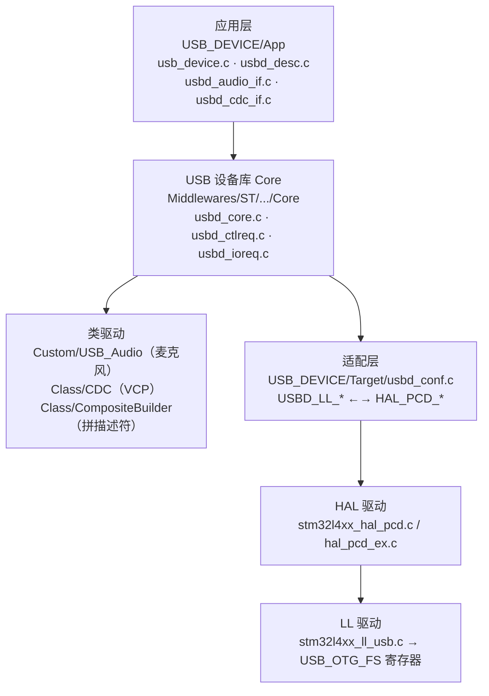
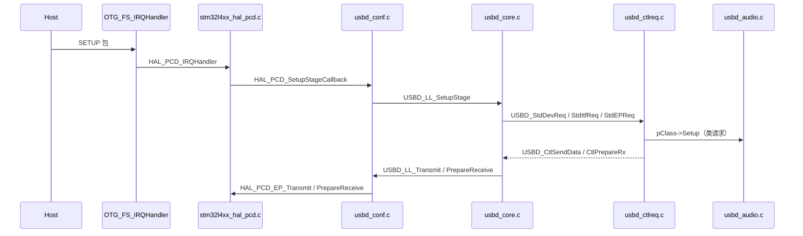

# USB 模块学习路线（STM32L475 OTG_FS + 复合设备）

本文档面向"接手本仓库 USB 部分"的开发者，目标是用最短路径做到两件事：

1. **系统性看懂本工程 USB 代码**——每一行属于哪一层、为什么这样写。
2. **熟悉 STM32 USB 外设本身**——FIFO、中断、时钟、端点这些硬件概念。

配套阅读：

- [STM32_USB_官方Wiki翻译.md](./STM32_USB_官方Wiki翻译.md) — USB 基础概念与 ST 库结构（中文）
- [usb_composite_vcp.md](./usb_composite_vcp.md) — 本工程复合设备改造全过程与踩坑记录
- [Debug_与_RTT_调试指南.md](./Debug_与_RTT_调试指南.md) — 日志/RTT 调试方法

## 目录

| 章节 | 内容 |
|---|---|
| 0 | 三层心智模型——判断一行代码属于哪一层 |
| 1 | 文件地图 + 关键宏速查 |
| 2 | 五阶段学习路线（0 协议 → 1 装配 → 2 枚举 → 3 Audio → 4 复合 → 5 外设） |
| 3 | FIFO 分配（改动端点必看） |
| 4 | 调试手段 + 现有诊断量 |
| 5 | 五个必须自己复现的陷阱 |
| 6 | 外部资料 |
| 7 | 验收清单 |
| 8 | 建议的学习节奏 |
| 9 | 动手速查（构建/日志/断点/文档分工） |

---

## 0. 先建立三层心智模型

USB 学不会通常不是协议难，而是**不知道一行代码属于哪一层**。本工程严格分成三层：



**读代码时永远先问：这一层该干什么？**

| 层 | 只负责 | 不该出现 |
|---|---|---|
| 应用层 | 设备描述符、类回调实现、业务数据搬运 | 寄存器操作、SETUP 解析 |
| Core | 设备状态机、标准请求、EP0 控制传输 | 音频/串口业务 |
| 类驱动 | 类专有请求、端点收发策略 | HAL 调用 |
| `usbd_conf.c` | `USBD_LL_*` → `HAL_PCD_*`、FIFO 分配、静态内存池 | 业务逻辑 |
| HAL / LL | 操作 OTG 寄存器、中断分发 | 任何协议语义 |

判断标准很简单：**看到 `HAL_PCD_*` 就在适配层以下，看到 `USBD_LL_*` 就在 Core，看到 `req->bRequest` 就在 Core/类驱动，看到 `USBD_AUDIO_ItfTypeDef` 就在应用层。**

---

## 1. 文件地图（按阅读优先级）

| # | 文件 | 为什么必读 | 入口 |
|---|---|---|---|
| 1 | [usb_device.c](../USB_DEVICE/App/usb_device.c) | 整个 USB 的"装配图"：`USBD_Init` → `RegisterClass` → `RegisterClassComposite` × 2 → `pUserData[0/1]` → `Start` | `MX_USB_DEVICE_Init()` |
| 2 | [usbd_conf.c](../USB_DEVICE/Target/usbd_conf.c) | `USBD_LL_Init`：PCD 初始化 + FIFO 分配 + 静态内存池。软件栈与硬件的唯一缝合点 | `USBD_LL_Init()` / `HAL_PCD_MspInit()` |
| 3 | [usbd_core.c](../Middlewares/ST/STM32_USB_Device_Library/Core/Src/usbd_core.c) | `USBD_LL_SetupStage` / `DataInStage` / `DataOutStage` / `SetClassConfig`：一次枚举的全部动作 | `USBD_LL_SetupStage()` |
| 4 | [usbd_ctlreq.c](../Middlewares/ST/STM32_USB_Device_Library/Core/Src/usbd_ctlreq.c) | 标准请求解析：`USBD_StdDevReq` → `USBD_GetDescriptor` → `USBD_SetConfig`。协议最直接的教科书 | `USBD_StdDevReq()` |
| 5 | [usbd_audio.c](../Middlewares/Custom/USB_Audio/Src/usbd_audio.c)（自定义） | 本项目核心类：Setup 请求、每 1 ms 发一包的 `USBD_AUDIO_SOF`、环形缓冲读写指针 `USBD_AUDIO_Sync` | `USBD_AUDIO_SOF()` |
| 6 | [usbd_audio_if.c](../USB_DEVICE/App/usbd_audio_if.c) | 把 USB 的 START/STOP 映射到 ES8388 + SAI DMA；`AUDIO_IF_ReportDiagnostics` 诊断上报 | `AUDIO_AudioCmd_FS()` |
| 7 | [usbd_composite_builder.c](../Middlewares/ST/STM32_USB_Device_Library/Class/CompositeBuilder/Src/usbd_composite_builder.c) | 配置描述符是**运行时拼出来的**，`USBD_CMPSIT_AUDIODesc` 是 Windows 报代码 10 的根源 | `USBD_CMPSIT_AddToConfDesc()` |
| 8 | [usbd_desc.c](../USB_DEVICE/App/usbd_desc.c) | 设备/字符串描述符 + PID（0x5745） | `FS_Desc` |
| 9 | [usbd_conf.h](../USB_DEVICE/Target/usbd_conf.h) | `USBD_MAX_NUM_INTERFACES=4`、`USBD_malloc` 宏、调试等级开关 | — |
| 10 | [user.cmake](../user.cmake) | 复合设备的全部编译定义（端点重映射、`USBD_AUDIO_CAPTURE_DESC`、IAD） | `USB_COMPOSITE_DEFINITIONS` |

### 关键宏速查

| 宏 | 值 | 位置 | 含义 |
|---|---|---|---|
| `USBD_MAX_NUM_INTERFACES` | 4 | [usbd_conf.h](../USB_DEVICE/Target/usbd_conf.h) | Audio 2 + CDC 2；标准请求的接口号校验上界 |
| `USBD_AUDIO_FREQ` | 48000 | [usbd_conf.h](../USB_DEVICE/Target/usbd_conf.h) | 采样率，决定包长 |
| `AUDIO_OUT_PACKET` | 192 | [usbd_audio.h](../Middlewares/Custom/USB_Audio/Inc/usbd_audio.h) | 48000×2ch×2B/1000 |
| `AUDIO_OUT_PACKET_MAX` | 193 | 同上 | 补偿包长；**48 kHz 下不会用到**（见阶段 3 的推导） |
| `AUDIO_OUT_PACKET_NUM` | 64 | 同上 | 缓冲子包数 |
| `AUDIO_TOTAL_BUF_SIZE` | 12288 | 同上 | 约 64 ms 环形缓冲 |
| `CDC_IN_EP` / `CDC_OUT_EP` / `CDC_CMD_EP` | 0x82 / 0x01 / 0x83 | [user.cmake](../user.cmake) | 避开 Audio 占用的 0x81 |
| `USBD_STATIC_POOL_SIZE` | `sizeof(Audio句柄)+640` | [usbd_conf.c](../USB_DEVICE/Target/usbd_conf.c) | bump allocator 池，加新类要重算 |

---

## 2. 五阶段学习路线

### 阶段 0（约 1 天）：协议概念，只求"能对上号"

读 [Wiki 翻译第 1 章](./STM32_USB_官方Wiki翻译.md)，必须能用自己的话回答：

- endpoint / transfer type（control、bulk、interrupt、isochronous）的区别
- transaction（SETUP / IN / OUT + ACK / NAK / STALL）与 frame（1 ms）的关系
- 枚举的 8 个步骤：复位 → 地址 0 → GET_DESCRIPTOR(Device) → SET_ADDRESS → GET_DESCRIPTOR(Config) → SET_CONFIGURATION → 类请求
- 为什么等时传输没有握手/重传 → 所以本工程要自己用 `packet_accum` 做包长补偿、用 `rate_adjust_accum` 做漂移补偿

### 阶段 1（约 2 天）：只看应用层，把"装配"看懂

只读 [usb_device.c](../USB_DEVICE/App/usb_device.c)、[usbd_conf.c](../USB_DEVICE/Target/usbd_conf.c)、[usbd_conf.h](../USB_DEVICE/Target/usbd_conf.h)。

装配顺序（务必背下来）：

```
USBD_Init(&hUsbDeviceFS, &FS_Desc, DEVICE_FS)
  → USBD_RegisterClass(&USBD_CMPSIT)                      // 复合容器
    → USBD_RegisterClassComposite(&USBD_AUDIO, AudioEpAdd) // classId 0
      → USBD_RegisterClassComposite(&USBD_CDC, CdcEpAdd)   // classId 1
        → pUserData[0] = &USBD_AUDIO_fops_FS               // 手写，不用 RegisterInterface
        → pUserData[1] = &USBD_CDC_fops_FS
          → classId = 0
            → USBD_Start()
```

**动手实验**

1. 把 `USBD_MAX_NUM_INTERFACES` 改成 2 → 编译上板，观察 SET_INTERFACE 被拒（理解这个宏校验什么）。
2. 把 `HAL_PCDEx_SetTxFiFo(..., 1, 0x40)` 改成 `0x10` → 音频断续，理解 FIFO 深度与端点带宽的关系。
3. 在 `MX_USB_DEVICE_Init` 各步打断点，用 **USB Device Tree Viewer** 对比每次枚举进度。

### 阶段 2（约 3 天）：追一次完整枚举（最关键）

按这条链单步走一遍，每个函数都读注释和关键分支：



入口在 [stm32l4xx_it.c](../Core/Src/stm32l4xx_it.c) 的 `OTG_FS_IRQHandler`，回调绑定在 `HAL_PCD_MspInit` / `USBD_LL_Init`。

**必须搞清的 4 个点**

1. `USBD_SetClassConfig` 怎么遍历 `classId`，为什么 `pUserData[]` 错位就 HardFault。
2. `USBD_LL_DataInStage` 里 EP0 状态机（`USBD_STATE_STATUS_IN` 等）如何收尾。
3. `USBD_GetDescriptor` 里配置描述符从哪来（复合设备 → CompositeBuilder）。
4. `USBD_LL_Reset` 做了什么（地址归零、端点全部关闭、`pClassDataCmsit[]` 清空）。

**验证**：用 **Wireshark + USBPcap** 抓一次插拔，把 Enumeration 的 8 个 URB 与代码逐条对应。

### 阶段 3（约 3 天）：吃透 Audio 类（本工程技术核心）

阅读顺序：`usbd_audio.h` → `usbd_audio.c` → `usbd_audio_if.c`。

三条数据通路：

| 通路 | 触发 | 代码路径 |
|---|---|---|
| 主机开麦 | `SET_INTERFACE` alt=1 | `USBD_AUDIO_Setup` → `fops->AudioCmd(AUDIO_CMD_START)` → `AUDIO_AudioCmd_FS` → `ES8388_StartAdc` + `HAL_SAI_Receive_DMA` |
| 数据进环形缓冲 | SAI DMA 半/全传输中断 | `HAL_SAI_RxHalfCpltCallback` / `HAL_SAI_RxCpltCallback` → `USBD_AUDIO_Sync` 改 `wr_ptr` |
| 数据出到 USB | 每 1 ms SOF 中断 | `USBD_AUDIO_SOF` 按 `rd_ptr` 拷一包 → `USBD_LL_Transmit` |

**环形缓冲的"指针约定"（最容易看错的地方）**

`USBD_AUDIO_Sync()` **不是**在累加写指针，而是直接把 `wr_ptr` 设为固定位置：

```c
if (offset == AUDIO_OFFSET_HALF)      wr_ptr = AUDIO_TOTAL_BUF_SIZE / 2;  /* DMA 填满了前半 */
else if (offset == AUDIO_OFFSET_FULL) wr_ptr = 0U;                        /* DMA 绕回填后半 */
haudio->rd_enable = 1U;
```

- SAI DMA 以半缓冲为单位循环搬运，**DMA 的写入地址就是** `buffer[0]` 或 `buffer[HALF]`。
- `wr_ptr` 的语义是"**当前有效数据的末尾（不含）**"：
  - HALF 回调后 DMA 转去写后半，有效数据是 `[0, HALF)`，`wr_ptr = HALF`；
  - FULL 回调后 DMA 绕回写前半，有效数据只剩 `[rd_ptr, END)`，`wr_ptr = 0` 表示**回绕段为空**。
- `USBD_AUDIO_SOF` 里就是按"从 `rd_ptr` 数到 `wr_ptr`"计算 `available` 的
  （`wr_ptr >= rd_ptr` 取差值，否则取 `TOTAL - rd_ptr + wr_ptr`），
  所以这里的 `wr_ptr` **不是累加式写指针**，不要按普通环形缓冲去理解。
- 隐含前提：`rd_ptr` 必须始终追在 DMA 后面。一旦读者落后超过一个半区，
  `available` 会算成整个后半区甚至更大，表现为重复/花屏式爆音——
  这正是 `iso_incomplete_count` 和 `rate_adjust_accum` 要监控的失效模式。
- `rd_ptr` 由 `USBD_AUDIO_SOF` 推进，跨过边界时 `-= AUDIO_TOTAL_BUF_SIZE` 回绕。
- 两者**只在不同的执行上下文**里被写（`rd_ptr` 在 OTG SOF 中断、`wr_ptr` 在 SAI DMA 中断），
  而本工程把它们配成**同一抢占优先级 5**（`OTG_FS_IRQn` 在 `HAL_PCD_MspInit`，
  `DMA2_Channel2_IRQn` 在 `MX_DMA_Init`），因此二者**不会互相打断**，
  这是本设计不需要临界区的前提。**改动任一中断优先级都可能引入竞态，务必保持同级。**

DMA 侧配置（`HAL_SAI_MspInit`）：

| 项 | 值 | 说明 |
|---|---|---|
| 通道 | `DMA2_Channel2`（`hdma_sai1_b`） | SAI1 Block B = 采集 |
| 方向 | `DMA_PERIPH_TO_MEMORY` | SAI → 内存 |
| 模式 | `DMA_CIRCULAR` | 循环，天然产生半/全两个回调 |
| 数据宽度 | `HALFWORD`（16 bit） | 与 2ch/16bit 格式一致 |
| 内存增量 | `DMA_MINC_ENABLE` | 依次填 `haudio->buffer` |

必须能自己推导：

- `AUDIO_OUT_PACKET = 48000×2×2/1000 = 192`（每 1 ms 帧 48 个样点 × 2 声道 × 2 字节），`AUDIO_OUT_PACKET_MAX = 193`
- 补偿包长逻辑（`USBD_AUDIO_SOF` 内）：

  ```c
  packet_accum += (USBD_AUDIO_FREQ * 4U) % 1000U;   /* 每帧应补的"零头" */
  if (packet_accum >= 1000U) { packet_accum -= 1000U; packet_size = 193U; }
  ```

  这里的关键结论：**48 kHz 下 `48000*4 % 1000 == 0`，累加器永远是 0，193 字节分支从不触发**——因为 48000 恰好能被 1000 整除，192 字节/ms 是精确值。
  该机制是为 44100 这类不能整除的采样率准备的（`44100*4 % 1000 = 400`，每 2.5 帧补 1 字节）。
  改 `USBD_AUDIO_FREQ` 前必须重新算这个余数，否则音频会有周期性爆音或延迟漂移。
- `AUDIO_TOTAL_BUF_SIZE = 192×64 = 12288`（约 64 ms），为什么 `wr_ptr` 只在 SAI 半/全传输中断里跳变
- `rate_adjust_accum >= 56` 且积压超过半缓冲时 `source_advance += 4`：
  4 字节 = 1 个立体声 16 bit 样点帧，即每 56 ms 主动丢弃 1 帧来排空积压，
  抵消 USB 主机时钟与 SAI 时钟不同源造成的缓冲持续增长（丢样换取延迟稳定）

**动手实验**

1. `AUDIO_OUT_PACKET_NUM` 从 64 改成 8 → 缓冲变浅，观察 `iso_incomplete` 计数与断音。
2. 注释掉 `USBD_AUDIO_SOF` 里的 `rate_adjust_accum` 分支，录音 10 分钟，用 Audacity 看周期性丢样。
3. 在 `USBD_AUDIO_SOF` 的 `tx_fail_count++` 处加日志，人为制造一次发送失败看诊断上报。

### 阶段 4（约 2 天）：CDC 类 + 复合机制

- [usbd_cdc.c](../Middlewares/ST/STM32_USB_Device_Library/Class/CDC/Src/usbd_cdc.c)（官方，读 `Setup` 与 `DataIn/DataOut`）
- [usbd_cdc_if.c](../USB_DEVICE/App/usbd_cdc_if.c)（本工程环形缓冲 + `VCP_Write/Read/Available/IsConnected`）
- [usbd_composite_builder.c](../Middlewares/ST/STM32_USB_Device_Library/Class/CompositeBuilder/Src/usbd_composite_builder.c) 的 `AddClass` / `AddToConfDesc` / `FindFreeIFNbr` / `AssignEp` / `SetClassID`

**核心问题**

1. 为什么端点要重映射成 `0x82 / 0x83`？（官方 CDC 默认 0x81/0x82，与音频等时 IN 0x81 冲突）
2. 为什么 `pUserData[]` 要手写而不调 `USBD_CLASS_RegisterInterface()`？（`RegisterClassComposite` 内部已 `classId++`）
3. 为什么必须有 IAD？（`bDeviceClass=0x00` + 多接口，没有 IAD 主机无法绑定功能）

**动手实验**：给复合设备再加一个 HID 类（鼠标），完整走一遍"分配端点 → 加 FIFO → 加描述符 → 注册 fops"。这是检验是否真懂复合机制的最好方式。

### 阶段 5（持续）：外设层面（STM32L475 OTG_FS）

读 `Drivers/STM32L4xx_HAL_Driver/Src/stm32l4xx_ll_usb.c` 的 `USB_CoreInit` / `USB_EPStartXfer` / `USB_ReadPacket`，对照 **RM0395 第 40 章 USB OTG FS**。

必须理解：

- **FIFO 架构**：共享 RX FIFO + 每端点独立 TX FIFO，深度单位是 32-bit word，总预算 320 词
- **中断架构**：`OTG_FS_IRQHandler` 是唯一入口，`GINTSTS` 按位分发（SOF / RXFLVL / 枚举完成 / USBRST …）
- **时钟**：USB 需要精确 48 MHz，本工程来自 **PLLSAI1**：HSE 8 MHz → M=1 / N=24 → VCO 192 MHz → Q=÷4 = **48 MHz**，
  在 `HAL_PCD_MspInit` 里配置（`RCC_USBCLKSOURCE_PLLSAI1` + `RCC_PLLSAI1_48M2CLK`）。
  同一颗 HSE 还喂 PLLSAI2 给 SAI：8 MHz → N=26 → P=÷17 ≈ 12.24 MHz（`RCC_SAI1CLKSOURCE_PLLSAI2`），
  再由 SAI1 Block A 的主分频器产生 48 kHz 的 BCLK/LRCK（`MX_SAI1_Init` 里 `SAI_MODEMASTER_TX` + `SAI_AUDIO_FREQUENCY_48K`）。
  Block B 是 `SAI_MODESLAVE_RX` + `SAI_SYNCHRONOUS`，即**跟着 Block A 的时钟采样**。
  **USB（PLLSAI1）与 SAI（PLLSAI2）用两个独立 PLL**，两个 48 k 互不锁定，
  这正是需要 `rate_adjust_accum` 做漂移补偿的根因。
- **VBUS / VDDUSB**：`HAL_PWREx_EnableVddUSB()` 必须开，否则 PHY 不上电、枚举直接失败。
- **DMA vs 中断**：USB 端点传输走中断 + 软件拷贝（未开 OTG DMA）；SAI 采集走 DMA2 循环模式。

---

## 3. FIFO 分配（务必记牢）

`HAL_PCDEx_SetTxFiFo()` / `SetRxFiFo()` 的参数单位是 **32 位字数**，不是字节。

| FIFO | 字 | 字节 | 用途 |
|---|---|---|---|
| RX | 128 | 512 | CDC bulk OUT、控制 SETUP |
| TX 0 | 64 | 256 | EP0 / 非周期 IN |
| TX 1 | 64 | 256 | EP1 IN：Audio 等时 IN（193 B/帧） |
| TX 2 | 16 | 64 | EP2 IN：CDC bulk IN |
| TX 3 | 16 | 64 | EP3 IN：CDC interrupt IN（8 B） |
| **合计** | **288** | 1152 | 预算 320 字（1280 B） |

- 每个 TX FIFO 最少 16 字（OTG 内核要求）。
- 合计超过 320 字会**破坏外设 FIFO 配置**（表现为随机 HardFault / 枚举失败），不会报错。
- 改动任何端点或包长，这三处必须同步：`user.cmake` 编译定义、`usb_device.c` 的 `CdcEpAdd[]`/`AudioEpAdd[]`、`usbd_conf.c` 的 FIFO 分配。

---

## 4. 调试手段（比读代码更有效）

| 手段 | 用途 | 工程现状 |
|---|---|---|
| **USB Device Tree Viewer** | 看描述符树、端点、当前 alt setting | 必备；"代码 10"类问题第一现场 |
| **Wireshark + USBPcap** | 看每次 SETUP/IN/OUT、SOF 时序 | 排查枚举失败最准 |
| 串口日志 | `AUDIO_IF_ReportDiagnostics()` 已做增量上报 | USART1 115200 8N1；`config.h` 的 `CONFIG_LOG_OUTPUT_RTT=1` 可切 RTT |
| 全局变量观察 | `audio_if_diagnostics`（应用层）与 `USBD_AUDIO_GetDiagnostics()`（类层） | 已封装，FreeMASTER 或 debugger watch 都能看 |
| 断点 | 只在 `Setup` / `SetClassConfig` 上打 | **绝不能在 SOF 回调里打断点**（1 ms 中断，必崩/必乱） |
| 描述符离线校验 | `python Tool/decode_cfgdesc.py <dump>` | 检查 `wTotalLength`、`bNumInterfaces`、端点重复/类型不符、音频终端拓扑方向 |
| GDB 脚本化取证 | `Tool/usb_trace.gdb` / `usb_state.gdb` / `usb_fault.gdb` | 在 IDE 的 GDB 控制台 `source` 即可，自动断点 + 打印设备状态 |

**建议顺序**：先让日志说话 → 再用 Device Tree Viewer 确认描述符 → 最后才上抓包。

### 现有诊断量说明

| 变量 | 位置 | 含义 |
|---|---|---|
| `audio_if_diagnostics.error_count` / `last_error` | 应用层 | `AUDIO_AudioCmd_FS` 各阶段失败次数与最后阶段 |
| `audio_if_diagnostics.dma_half_count` / `dma_full_count` | 应用层 | SAI RX DMA 回调计数，判断采集是否在跑 |
| `class_diagnostics.sof_count` | 类层 | SOF 回调执行次数 |
| `class_diagnostics.tx_count` / `tx_fail_count` | 类层 | IN 传输完成/失败次数 |
| `class_diagnostics.iso_incomplete_count` | 类层 | 等时 IN 未完成次数（带宽不足信号） |
| `class_diagnostics.set_interface_fail_count` | 类层 | 启停采集失败次数 |
| `class_diagnostics.open_ep_fail_count` | 类层 | 端点打开失败 |

---

## 5. 五个必须自己复现的陷阱

均在 [usb_composite_vcp.md](./usb_composite_vcp.md) 第 5 节有记录，但**看懂 ≠ 会**：

1. **Audio 拓扑方向反了 → 代码 10**
   Input Terminal `0x0101` 表示"主机喂数据"（播放）。麦克风必须：
   `Microphone IT(0x0201) → Feature Unit → USB Streaming OT(0x0101)`，
   AudioStreaming 接口的 `bTerminalLink` 指向那个 **Output Terminal**。
   注意 Feature Unit 的 `bLength` 必须与 `bNrChannels` 匹配（2 声道 → 3 个 bmaControls → `bLength=10`）。

2. **`RegisterInterface()` 落到错槽位**
   `USBD_RegisterClassComposite()` 内部已 `classId++`，再调 `USBD_AUDIO_RegisterInterface()` 会把 fops 写进 `pUserData[1]`，`pUserData[0]` 保持 NULL → `Init()` 空指针 HardFault。
   **不要**试图通过"注册前手动设 classId"来修（会让第二个类被静默跳过）。

3. **`USBD_static_malloc` 忽略 size**
   CubeMX 单类版本永远返回同一块缓冲，两个类拿到同一地址，后初始化的 CDC 用 `memset` 清掉 Audio 句柄开头。
   现为 bump allocator；`USBD_static_free` 回退指针。**新增任何 USB 类都要重算 `USBD_STATIC_POOL_SIZE`**。

4. **FIFO 超 320 词**
   破坏外设配置，不报错。

5. **端点地址三处必须同步**
   `user.cmake`（`CDC_IN_EP` 等）↔ `usb_device.c`（`CdcEpAdd[]`）↔ `usbd_conf.c`（FIFO 分配）。

---

## 6. 外部资料（按性价比排序）

1. **RM0395 第 40 章**（USB OTG FS）— 外设层唯一权威
2. **USB 2.0 Spec 第 9 章**（Device Framework）— 描述符与标准请求原始定义，只需读 9.3 / 9.4 / 9.6
3. **USB Audio 1.0 Class Spec** — 第 2 章（拓扑）、第 3 章（描述符）、第 4 章（等时端点要求）
4. **ST AN4879** — USB 硬件与 PCB 布线指南
5. ST Wiki *Introduction to USB with STM32*（仓库内已有中文翻译）

---

## 7. 验收清单

能独立回答下面全部问题，才算真正掌握：

- [ ] 插上 USB 到 Windows 认出麦克风，一共发生了哪些控制传输？各自在哪个函数处理？
- [ ] 为什么音频用等时端点而不是批量端点？丢了数据怎么办？
- [ ] 192 字节/ms 从哪来？`AUDIO_OUT_PACKET_MAX=193` 在本工程实际会被用到吗？为什么？
- [ ] `wr_ptr` 和 `rd_ptr` 分别由谁改？为什么不会互相踩？
- [ ] 加第三个 USB 类需要改哪几个文件？每处改什么？
- [ ] 把 PID 改成别的值，为什么 Windows 会重新枚举？
- [ ] `USBD_LL_Reset` 之后到 `SET_CONFIGURATION` 之间，`pClassDataCmsit[]` 是什么状态？
- [ ] `USBD_MAX_NUM_INTERFACES` 校验的是哪类请求？设小了会怎样？
- [ ] FIFO 总预算为什么是 320 词？超了会怎样？
- [ ] 为什么必须 `HAL_PWREx_EnableVddUSB()`？

---

## 8. 建议的学习节奏

| 天 | 内容 | 产出 |
|---|---|---|
| D1 | 阶段 0：协议概念 | 能画出一次枚举的时序图 |
| D2–D3 | 阶段 1：应用层装配 | 能默写 `MX_USB_DEVICE_Init` 的顺序与理由 |
| D4–D6 | 阶段 2：完整枚举 | Wireshark 抓包与代码逐条对应表 |
| D7–D9 | 阶段 3：Audio 类 | 能讲清三条数据通路 + 推导弹出的数字 |
| D10–D11 | 阶段 4：CDC + 复合 | 独立加一个 HID 类 |
| D12+ | 阶段 5：外设层 | 能读 RM0395 第 40 章并对应到 LL 代码 |

---

## 9. 动手速查

### 构建与烧录

```powershell
# 构建（仓库根目录）
python Tool\build.py
# 或直接调用 CMake
& "$env:LOCALAPPDATA\stm32cube\bundles\cmake\4.2.3+st.1\bin\cmake.exe" --build build/Debug
```

配置阶段**必须**出现这一行，否则 `usbd_audio.h` 会解析到官方 Speaker 版：

```
-- user.cmake: dropping official AUDIO include dir: .../Class/AUDIO/Inc
```

### 打开/关闭日志

| 文件 | 宏 | 效果 |
|---|---|---|
| `APP/config.h` | `CONFIG_USE_FREEMASTER` | 1 → 诊断函数体为空、USART1 归 FreeMASTER；0 → 日志可用 |
| `APP/config.h` | `CONFIG_LOG_OUTPUT_RTT` | 1 → 同时输出到 SEGGER RTT 通道 0 |
| `APP/debug_log.c` | `s_log_level` | 默认 `LOG_LEVEL_DEBUG`；调低可只保留 ERROR/WARN |

### 一次枚举的关键断点位置

| 观察点 | 函数 | 位置 |
|---|---|---|
| 硬件中断入口 | `OTG_FS_IRQHandler` | [stm32l4xx_it.c](../Core/Src/stm32l4xx_it.c) |
| SETUP 包到达 | `USBD_LL_SetupStage` | [usbd_core.c](../Middlewares/ST/STM32_USB_Device_Library/Core/Src/usbd_core.c) |
| 标准请求分发 | `USBD_StdDevReq` / `USBD_StdItfReq` | [usbd_ctlreq.c](../Middlewares/ST/STM32_USB_Device_Library/Core/Src/usbd_ctlreq.c) |
| 取描述符 | `USBD_GetDescriptor` | 同上 |
| 激活配置 | `USBD_SetClassConfig` → 各类 `Init()` | [usbd_core.c](../Middlewares/ST/STM32_USB_Device_Library/Core/Src/usbd_core.c) |
| 主机开麦 | `USBD_AUDIO_Setup`（`USB_REQ_SET_INTERFACE`） | [usbd_audio.c](../Middlewares/Custom/USB_Audio/Src/usbd_audio.c) |
| 复位 | `USBD_LL_Reset` | [usbd_core.c](../Middlewares/ST/STM32_USB_Device_Library/Core/Src/usbd_core.c) |

> 断点只打在上面这些**控制路径**上。SOF / DataIn / DMA 回调是 1 ms 级高频路径，
> 在那里停下来会让主机判超时并复位设备。

### 与本仓库其它文档的分工

| 文档 | 定位 |
|---|---|
| 本文 | **学习路线**：先看什么、后看什么、怎么验证 |
| [usb_composite_vcp.md](./usb_composite_vcp.md) | **排错手册**：改造历史、报错→原因→修法对照表 |
| [STM32_USB_官方Wiki翻译.md](./STM32_USB_官方Wiki翻译.md) | **概念参考**：USB 协议与 ST 库结构 |
| [Debug_与_RTT_调试指南.md](./Debug_与_RTT_调试指南.md) | **调试配置**：串口/RTT/GDB 怎么用 |

### 注意：USB 已从 CubeMX 移除

`TEST.ioc` 里已删除 `USB_DEVICE` 与 `USB_OTG_FS`，因此：

- CubeMX 重新生成代码**不会**覆盖 `USB_DEVICE/` 与 `Middlewares/Custom/USB_Audio/`；
- 但也意味着**改 USB 配置不能靠 CubeMX**，必须手改 `usb_device.c` / `usbd_conf.c` / `user.cmake` 三处；
- 若误在 CubeMX 中重新勾选 USB，会生成冲突文件（详见 [usb_composite_vcp.md 第 7 节](./usb_composite_vcp.md)）。
